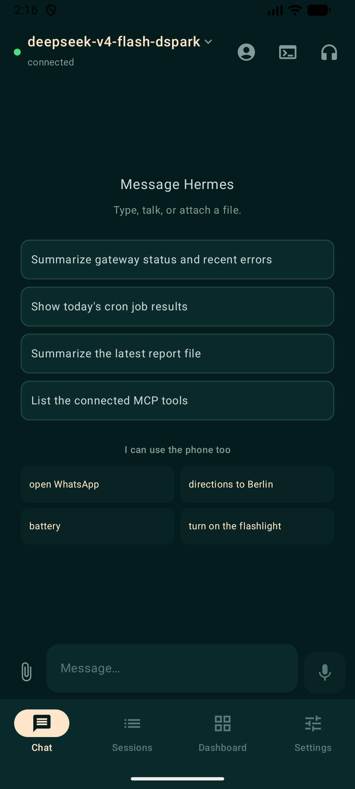
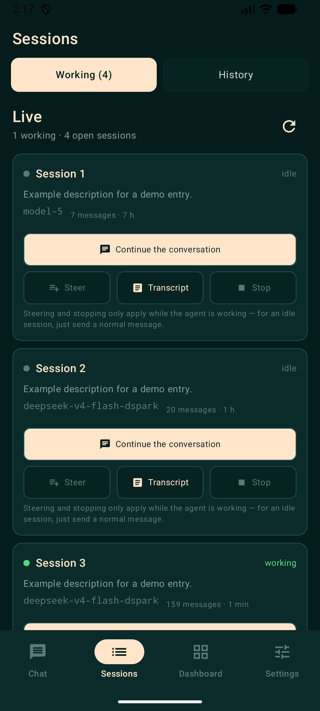
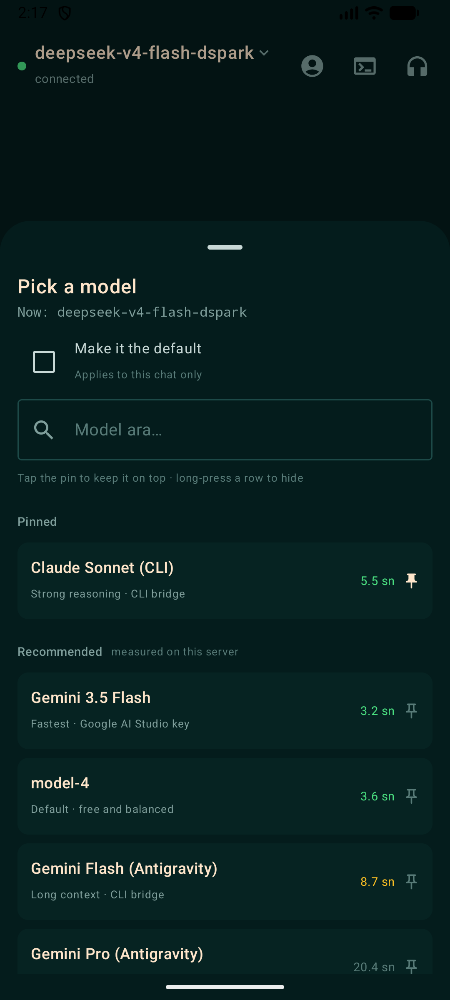
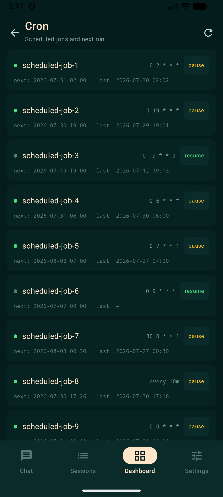
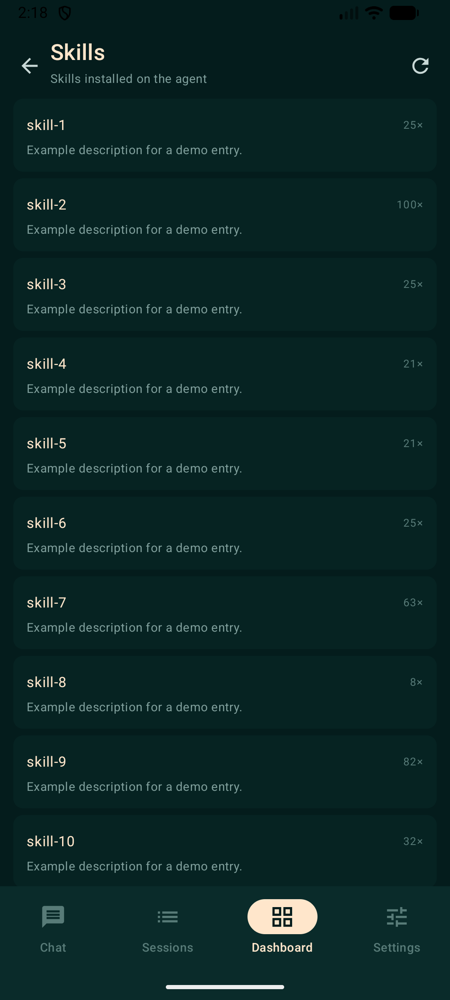
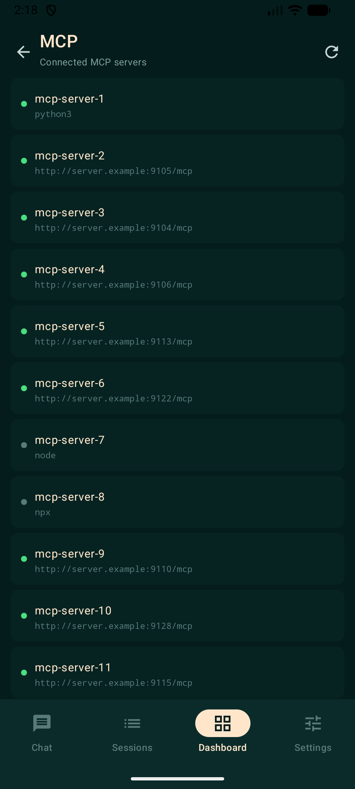
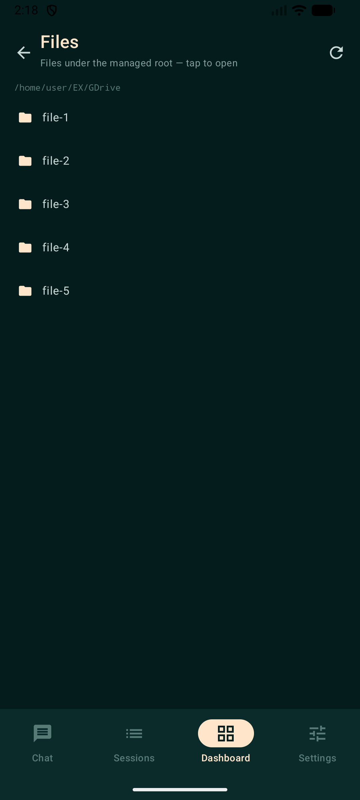
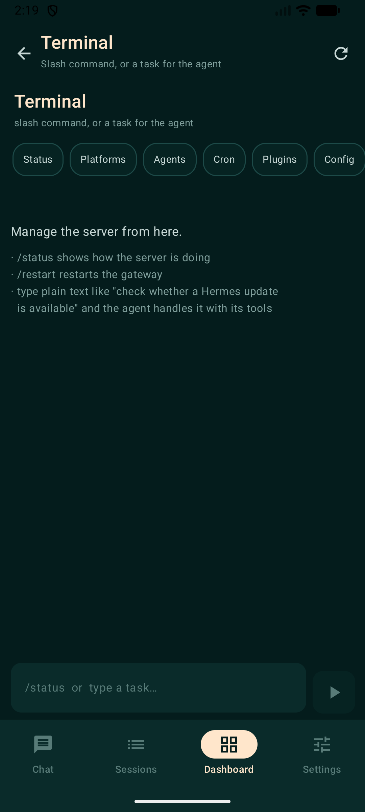
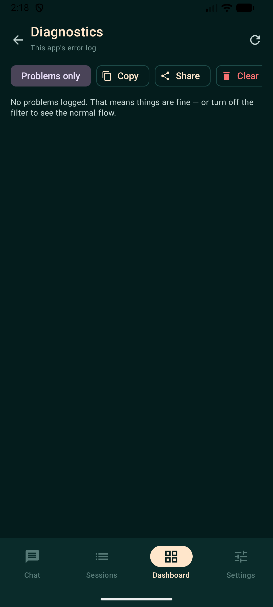

# Hermes Mobile

A native Android client for a self-hosted AI agent.

The agent, its tools, its memory and its schedule stay on hardware you own. The
phone is the surface: chat, sessions, server administration, and a two-way link
to the device itself. There is no hosted account, no cloud relay and no
telemetry — point the app at your own server or it does nothing.

Türkçe sürüm: [README.tr.md](README.tr.md)

---

## What this is

Hermes Mobile is a Kotlin / Jetpack Compose application that talks to a running
Hermes agent over its WebSocket and HTTP endpoints. It is a client, not a
backend: it does not include, host or provision an agent server, and keeping
that server reachable and secured is the operator's job.

- Native UI throughout; no WebView.
- Server profiles, tokens and keys are stored in `EncryptedSharedPreferences`
  backed by the Android Keystore.
- Live-voice API keys stay on the server; the phone only holds the session
  token.
- When something cannot work, the app reports the error instead of quietly
  switching to a different endpoint or model.

---

## Features

### Chat

Streaming replies over the agent's WebSocket protocol, with thinking blocks,
tool-call cards and approval prompts for dangerous commands. Images and files
can be attached; text or media can be shared into a new chat from other apps.
Messages composed while offline are queued and sent when the connection
returns.



### Sessions

Session list with a local cache, archive, pin, rename and follow. A session
started elsewhere — Telegram, a cron job, the CLI — appears here while it runs,
and a message can be injected into its current turn without discarding the work
already done. Multi-select merge moves several sessions into one.



### Models

A model picker that validates the choice against the server's live
`/v1/models` endpoint. Local LAN endpoints and remote providers are listed side
by side. The selection is a lock, not a preference: if the chosen endpoint is
down, the app shows an error rather than silently falling back.



### Scheduled jobs (cron)

List, pause, resume, reschedule and run scheduled agent jobs, with schedule,
last run and next run for each.



### Skills and MCP servers

Installed skills and configured MCP tool servers are visible from the phone and
can be enabled or disabled there, alongside webhooks, pairing and raw
configuration.





### Files and terminal

A file browser over the agent's workspace and a terminal that runs commands on
the server, using the same session token the app already holds.





### Diagnostics

Failures in a mobile agent client tend to be silent: a socket closes and the UI
keeps saying "Thinking", a schema changes and a list comes back empty, and
`adb logcat` only helps while the phone is on a cable. The app keeps its own
log — crashes, WebSocket close codes, HTTP status plus which address was tried,
JSON decode failures, session re-attach and the offline queue. Secrets are
redacted as entries are written, so the log is safe to copy and send.



### Android Auto

Two paths, kept separate on purpose:

- **Screen mirroring (with consent).** The phone's own screen is projected onto
  the car display through `MediaProjection`, so Android asks for confirmation
  before projection starts. This is the fallback path and always requires that
  consent.
- **Hermes panel (no consent).** The car app library hands the app a `Screen`
  with a `SurfaceCallback`; when the car surface arrives, the app creates a
  virtual display on it and renders Hermes' own interface through a
  `Presentation`. No `MediaProjection` is involved, so no confirmation dialog:
  the car surface itself is the display.

Voice runs on the phone and reaches the car over Bluetooth, because the Car App
Library cannot own the microphone. The app is sideloaded, so Android Auto needs
"Unknown sources" enabled in Auto's developer settings.

---

## Promo video

A short vertical clip assembled from the screenshots in this repository:

[docs/promo/hermes-mobile-promo.mp4](docs/promo/hermes-mobile-promo.mp4) —
1080×1920, H.264, silent, ~27 s.

---

## Install (APK)

There is no store release. Sideload the APK:

1. Download the APK from the releases page, or build it yourself (below).
2. On the phone, allow installation from the source you used (browser or file
   manager).
3. Open the app, add a server profile and enter the session token.

If a `.sha256` file is published with the APK, verify the download before
installing.

### Build from source

Requires JDK 17 and Android SDK Platform 35.

```bash
export ANDROID_HOME="$HOME/Library/Android/sdk"   # or your SDK location
export ANDROID_SDK_ROOT="$ANDROID_HOME"
./gradlew testDebugUnitTest
./gradlew assembleDebug
```

Output: `app/build/outputs/apk/debug/app-debug.apk`

The live-voice relay is a single Python service (`relay/`) run on the machine
hosting the agent; it reads the provider key and the session token from the
environment, and neither is ever sent to the phone.

---

## Connect a server

The app stores server profiles in `EncryptedSharedPreferences`. Plain HTTP is
accepted for private LAN addresses and rejected for public hosts.

- **Home network:** enter the server's LAN address, for example
  `http://192.168.1.20:9150`, plus its session token.
- **From outside:** put the agent behind a reverse proxy that terminates real
  TLS on a hostname you control and use `https://hermes.example.com`. The
  live-voice relay can be mounted as a path on the same origin
  (`/live-relay/*`) so no extra port has to be forwarded.
- **Tailscale:** put both machines on the same tailnet; nothing is exposed
  publicly.

If the app cannot reach the server, check in this order: the server is awake
and the agent is running; `/api/status` answers from another device on the same
route; the proxy or tunnel is up and the certificate is valid; the URL scheme,
port and token are correct. Dashboard → Diagnostics records which addresses
were tried and why each failed.

---

## Architecture

```
Phone (this app)                         Your server
┌─────────────────────────┐  WS/HTTPS   ┌──────────────────────────────┐
│ Compose UI              │◄───────────►│ Hermes agent (tools, memory, │
│ ChatViewModel           │  /api/ws    │ cron, Telegram, CLI)         │
│ Session store / cache   │             │ gateway :9150                │
│ VoiceApiClient          │──HTTP──────►│ /api/* endpoints             │
└──────────┬──────────────┘             │ live-voice relay :9170       │
           │                             │ phone_bridge :9180 + MCP     │
   local LLM (LAN)                       └──────────────────────────────┘
   /v1/chat/completions
```

- One long-lived WebSocket carries the event stream, thinking blocks, tool
  cards and approval requests. A dropped socket re-attaches to the same agent
  session.
- The live-voice relay is a small Python service on the server; it holds the
  provider key and verifies the same session token the app already has.
- The phone bridge reverses the direction: the phone opens an **outbound**
  WebSocket to the server, and the agent reaches the phone through an MCP tool
  server. NAT, CGNAT and mobile data stop mattering — no port forwarding, no
  VPN, no USB. It is off by default and read-only when first enabled; nothing
  irreversible is exposed (dialling opens the dialer, SMS stays a draft).

The server build the app was tested against is pinned in
[UPSTREAM_TESTED.md](UPSTREAM_TESTED.md), together with the tolerant-decoding
rules used for panels whose JSON shapes have changed over time.

---

## Compatibility

The upstream agent does not guarantee API stability, so a different server
version can break individual panels while the rest keeps working. Include your
server version when reporting a bug; the app shows it under Dashboard → Status.

---

## Privacy

Personal identifiers, internal hostnames, tokens and private addresses are
stripped before anything is published here. The screenshots in this repository
were taken with the app's demo mode enabled, which masks server-supplied text
(session titles, job names, skills, hostnames, file paths). See
[PRIVACY.md](PRIVACY.md) and [SECURITY.md](SECURITY.md).

---

## License

MIT — see [LICENSE](LICENSE). Third-party components and their notices are
listed in [CREDITS.md](CREDITS.md) and
`app/src/main/assets/THIRD-PARTY-NOTICES.txt`.

Not affiliated with Google or Anthropic. Android, Jetpack and Google Play are
trademarks of Google LLC.
