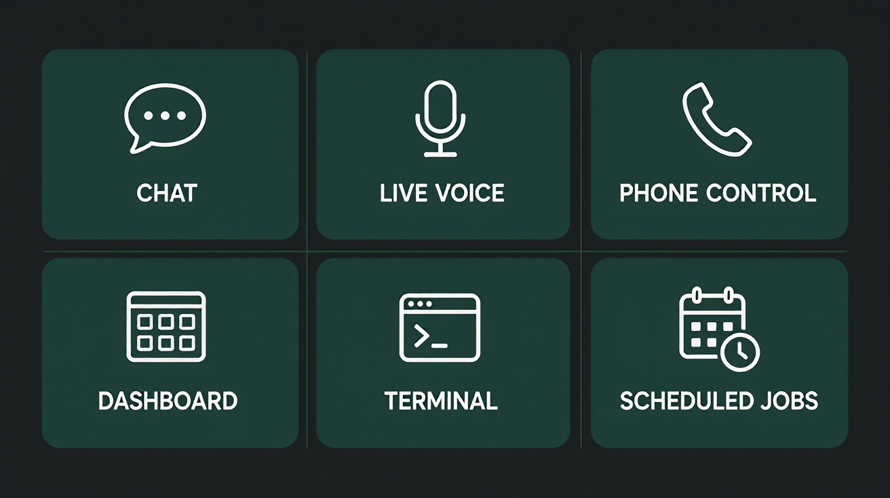

# Hermes Mobile

**Your Hermes workspace, in your pocket.**

An Android companion for a self-hosted [Hermes Agent](https://github.com/NousResearch/hermes-agent). Continue desktop conversations, open your agents, follow delegated work, preview documents, talk to your assistant and run small phone automations from one app.

**7.6.1 preview · Kotlin / Jetpack Compose · Android 8.0+**

[Features](#features) · [Get started](#get-started) · [Build](#build-from-source) · [Credits](CREDITS.md) · [English introduction](docs/ANNOUNCEMENT.en.md) · [Türkçe](README.tr.md)

> This is an independent community client, not an official Nous Research mobile release. Agent features require a compatible Hermes server. Models, tool access, provider accounts and their costs belong to the server you configure.

## What's new

- **Desktop agents, mobile conversations.** Bots → Hermes lists real Dashboard profiles and resumes their existing sessions instead of creating mobile copies.
- **A usable conversation archive.** Open the first page, then load more. Counters show loaded/total records; pinned rows are deduplicated without skipping pages.
- **Richer chat.** Selectable text, usable links, HTML document previews, audio controls and server-hosted media complement Markdown and code blocks.
- **A subagent task pipeline.** Read supplied statuses, models, tool/token counters, completion summaries and file information in the current conversation.
- **Clear macro outcomes.** Manual runs show a result dialog; permission failures, cooldowns and other preconditions appear in execution history.
- **Less repeated noise.** Dismissed historical crash notices stay dismissed; a new crash can still be reported.

## Features

### Your conversations, across devices

Streaming replies include reasoning sections, tool activity, approval cards and attachments. Share text/files into Hermes from other Android apps. Search cached sessions, pin, follow, rename or locally archive them. Profile-specific lists include archived conversations and preserve the owning profile when resuming.

Read-position tracking uses content anchors to reopen at the first unread section, or near the latest exchange when caught up. Broader long-history, multi-chat and process-restart acceptance testing remains open.

### Agents with personality

**Bots → Hermes** opens canonical server profiles and their conversations. **Agents / Tasks** retains custom companions, personalities, templates, local team grouping and task controls. Long-press and drop companions together to create a local team. The small companion faces are original Hermes UI work.

Team grouping does not merge agents' memory or silently expand their permissions. The optional custom-bot adapter uses the same Dashboard address/token through `/mobile-api/`; it must be deployed on your server. Mika/Phongent compatibility includes selected source adaptations and outbound protocol clients, not their complete phone runtimes.

### Follow delegated work

The collapsible task pipeline reads session-scoped `subagent.*` events and `subagent.list`. It refreshes while the conversation is visible, displays only supplied measurements and distinguishes an absent live record from a confirmed completion. This view does not automatically launch, interrupt or authorize child agents.

### Media and documents

| Content | Experience |
|---|---|
| Markdown and code | Headings, lists, code blocks, copying and text selection |
| Links | Open HTTP/HTTPS links, including links inside HTML previews |
| Images | Remote images and bounded inline PNG/JPEG/WebP/GIF content |
| Audio / video | Explicit playback controls; codec support depends on Android |
| Server files | Authenticated download within the server's access rules |
| HTML | Preview generated code or downloaded HTML documents without running scripts |

HTML previews disable JavaScript, network loading, local-file access and native bridges. External pages open through the link handler. Authenticated media downloads do not follow redirects, cap HTML at 2 MB and other files at 64 MB, and use a bounded temporary cache. The Dashboard token is not passed to the external browser or media decoder.



*Earlier public interface artwork. The text documents the current 7.6.1 features; it is not a new device-test screenshot.*

### Small automations, clear results

Native macros support manual, charging, unplugging, headset and unlock triggers. Supported actions include notifications, vibration, media volume and the flashlight. Permission checks, cooldowns, execution history and a visible foreground monitor make outcomes understandable.

Add a recipe → **Try manually → Run** → review the result. To use device events, enable both the rule and **Automatic rules**. Grant only the permissions the action needs. Imported rules start paused; unsupported actions and conditions are reported rather than silently approximated.

Public template copies replace embedded webhook capability URLs with inert placeholders. Configure your own endpoints when reviewing a template.

The bundled [MacroDroid collection](third_party/macrodroid/UPSTREAM.md) is a template collection, not the MacroDroid application. [OpenTasker reuse](third_party/opentasker/UPSTREAM.md) covers its cooldown reservation component, not its full automation engine.

### Voice and permissioned phone assistance

Voice input/output, optional wake-word support, assistant entry points and live voice/video depend on the configured services and models. Offline speech resources are downloaded separately. EMA needs a valid model configuration; system speech can be used when appropriate. Nefes weights are not bundled.

The outbound phone bridge exposes supported screen, navigation, app, text and notification tools under Android permissions, accessibility authorization and existing approval controls. It does not provide unrestricted access to every app or hidden access to encrypted message databases.

Shizuku API support is optional for specific elevated operations. The Shizuku manager/server is not embedded, and Android's startup authorization requirements still apply. Ordinary chat and native macros do not require it. A separate call-recorder interoperability path is optional; universal or Bluetooth call recording is not promised.

### Android Auto and Mola

Separate messaging, Car App Library, legacy compatibility and parked-screen paths are retained. The Mola guide covers setup and saved vehicle preferences. Depending on the host, parked surfaces include the Hermes panel, a small companion game, a YouTube web entry and consent-based mirroring.

Discovery and playback depend on the phone, installation path, head unit and host policy. A messaging entry does not prove parked-screen support. Mirroring needs MediaProjection consent; parked mirroring does not add phone-audio transport. Driving restrictions are retained. See the [Mola guide](docs/v7/mola.md) and [SDK provenance](third_party/mola/UPSTREAM.md).

### Your server tools, from a phone

Existing administration surfaces cover status, diagnostics, models, cron jobs, skills, MCP servers, workspace files, terminal access and approvals. Available operations depend on the server's API and authorization policy. Settings group conversation, appearance, voice, connection, phone control, vehicles, privacy and backups.

Export selected conversations and reopen them as a local archive. Exports and recordings are sensitive data: choose a destination yourself and protect the files. A conversation archive is not a complete server backup.

## Get started

1. Run a compatible Hermes Dashboard/gateway on hardware you control.
2. Build the app below or use a trusted APK. Check each asset's actual version on [Releases](https://github.com/Jilazem/Hermes-Mobil/releases): a source update does not mean a matching APK has been published there.
3. Add a reachable Dashboard URL, for example `https://hermes.example.com`, and its session token.
4. Open a conversation or **Bots → Hermes**. Configure optional voice, bot-adapter and phone-bridge services as needed.
5. Test macros manually before enabling events; complete Android's consent flow before device control or screen sharing.

Use HTTPS for remote access and protect the gateway. Do not expose unauthenticated phone-control endpoints or commit tokens, recordings, chat exports or private configuration.

Server setup: [Dashboard adapter](backend/DASHBOARD-INTEGRATION.md). External protocols: [Mika](docs/integration/mika.md), [Phongent](docs/integration/phongent.md). Normal Hermes phone assistance uses Hermes's own bridge.

## Build from source

Use **JDK 21**, Android SDK Platform 35 / Build Tools 35.0.0 and the included Gradle 8.9 wrapper. Minimum SDK is 26; some car and permission features need newer Android versions.

```bash
# Set JAVA_HOME and your Android SDK location for your machine.
./gradlew --no-daemon --max-workers=2 testDebugUnitTest assembleDebug lintDebug
```

On Windows use `gradlew.bat`. Keep machine-specific paths, `local.properties` and signing keys outside Git. Existing speech AARs belong to the base repository. **The Mola compatibility SDK is deliberately not distributed in this update.** A full build requires your own authorized local copy at `app/libs/mola-aauto.aar`; see [local build dependencies](docs/BUILDING.md) and [third-party terms](THIRD_PARTY.md).

Debug outputs are ABI-specific: `app/build/outputs/apk/debug/app-arm64-v8a-debug.apk` and `app-x86_64-debug.apk`. The default debug package is `com.hermes.mobile.v3`, with the `-preview` version suffix. Updating an installed APK requires the same signing certificate; a new local debug key cannot replace the maintainer's preview key.

The optional bot adapter pins its transport dependency in `backend/requirements-dashboard.txt`. Install it in a separate environment, not into a running agent's production runtime.

## Verification and limits

The delivered 7.6.1 implementation passed **1,573 Android unit tests on Windows and 1,573 on macOS**. Lint reported **0 errors, 74 warnings and 7 informational findings**. Publication adds documentation/license material and a portable JDK configuration; these counts do not prove every device, provider or deployment.

Physical-phone checks covered updating with the existing certificate, the retained disabled dual-app clone, canonical profile/session opening, HTML download/preview, opening its link in Chrome, an audio-file preview and manual notification macro execution. The automatic macro monitor was observed running. See [release validation](docs/releases/v7.6.1.md).

Separate acceptance remains for real charging events, reboot recovery, a real head unit, a populated live subagent task, broader unread-position/restart behavior and a physical image/video matrix. The current macro screen starts its monitor when enabled; unattended reboot recovery is not guaranteed. Audio audibility was not independently confirmed. Call recording and CSC modification were deferred.

## Credits, privacy and contribution

First-party code is covered by [MIT](LICENSE). Adapted source, templates, dependencies, models and SDK binaries retain their own terms; the root license does not relicense them. Read [Credits](CREDITS.md), [Third-party inventory](THIRD_PARTY.md), [Privacy](PRIVACY.md), [Security](SECURITY.md) and [Contributing](CONTRIBUTING.md).

This community project is not affiliated with or endorsed by Nous Research, Google, xAI, OpenAI, MacroDroid, Mika or Phongent. Names and trademarks belong to their respective owners.
